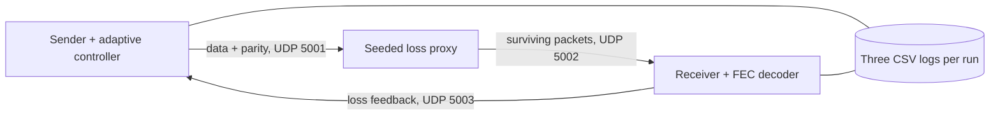
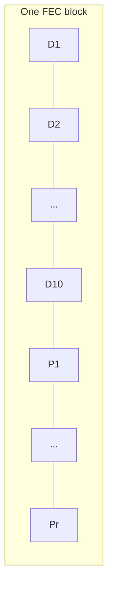
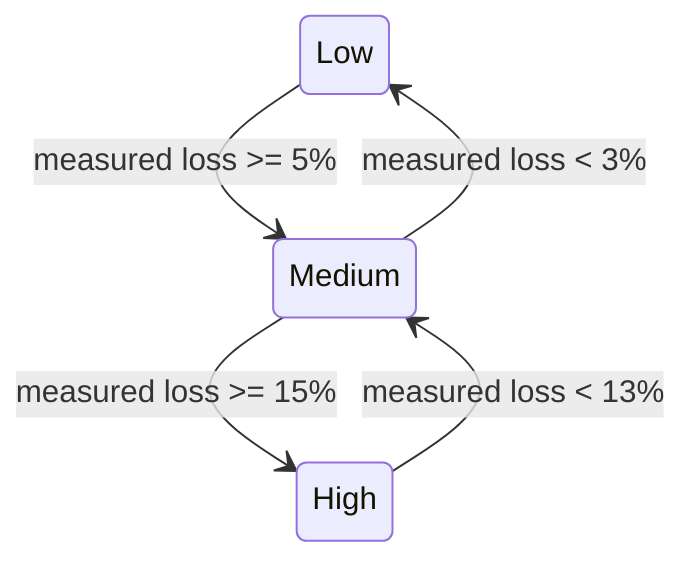
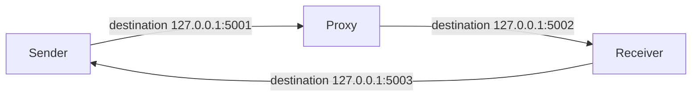

# Numbered system diagrams

## Figure 1 — End-to-end flow

**Figure 1.** Shows that every data/parity packet crosses the controlled loss
proxy and that receiver feedback closes the adaptation loop.

## Figure 2 — Block structure

**Figure 2.** Proves the block contains `k=10` data packets followed by `r`
parity packets, where `r` is 0, 1, 2, or 4 according to the scheme and level.

## Figure 3 — Controller state machine

**Figure 3.** Shows the low/medium/high thresholds and the two-percentage-point
downward hysteresis that prevents rapid state oscillation.

## Figure 4 — Localhost port layout

**Figure 4.** Identifies the three localhost ports so a packet capture can
separate outbound traffic, forwarded traffic, and control feedback.
